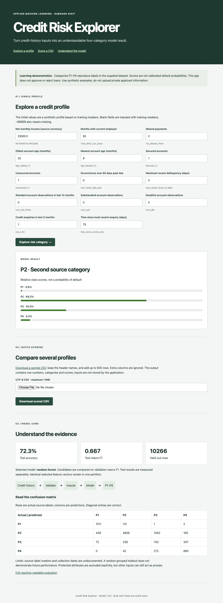
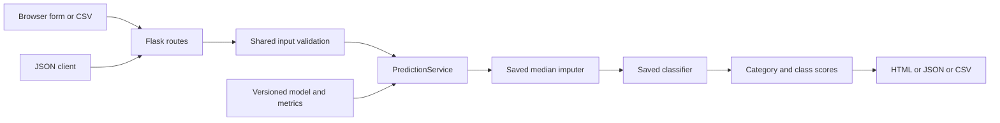
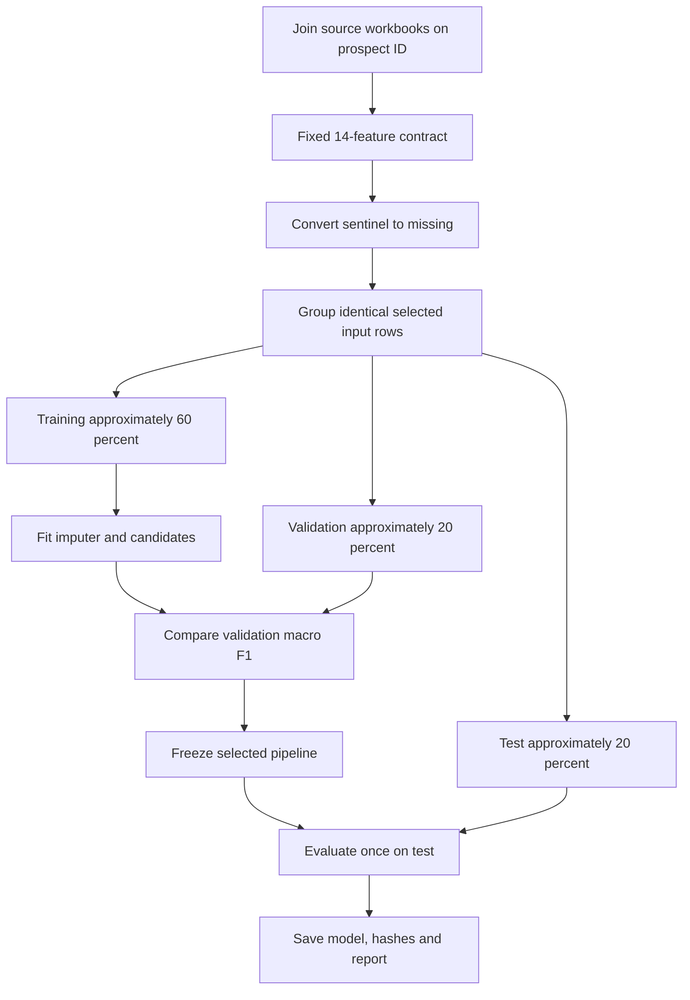
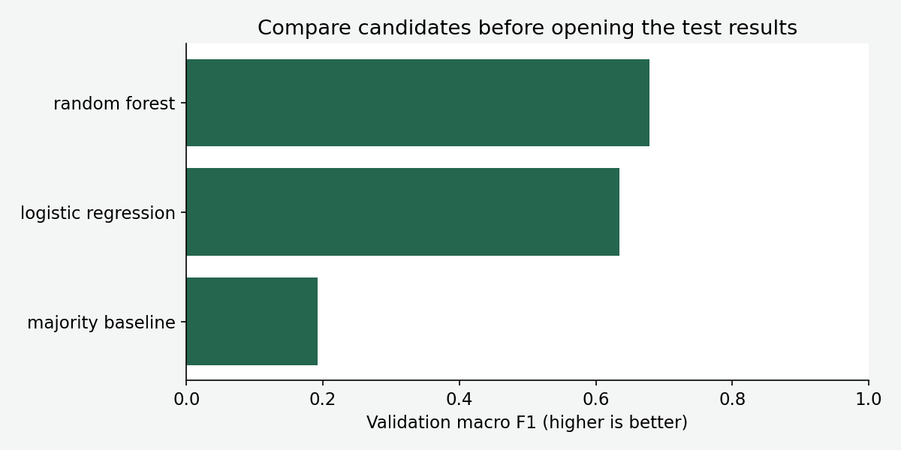
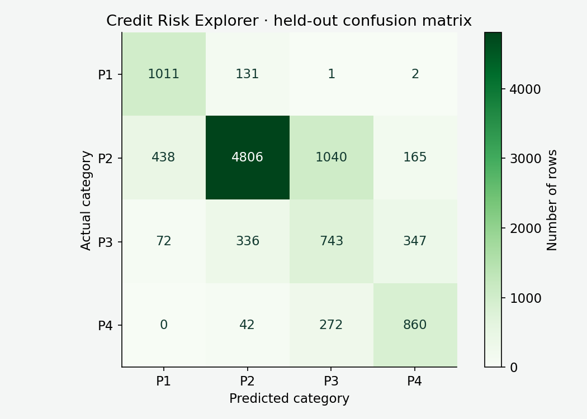
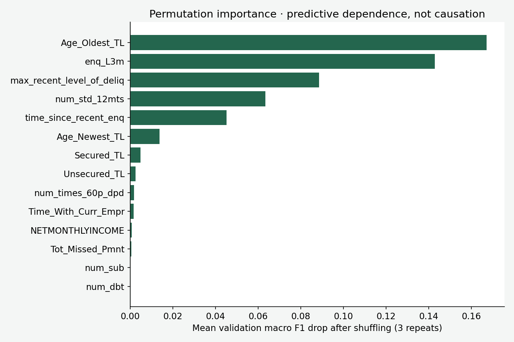
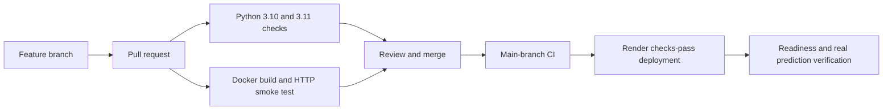

# Credit Risk Explorer

A reproducible **four-category credit-risk learning project**, with a Flask web application, JSON API, CSV scoring, measured evaluation and CI/CD configuration.

An analyst enters a synthetic credit-history profile and sees the model's P1–P4 category and relative class scores. A developer can reproduce the training, inspect the evaluation, run tests and deploy the same saved pipeline. The interface explains the result rather than making a lending decision.

> This is an educational portfolio application. Source labels describe four ordered categories, not observed default events. Scores are **not calibrated probabilities of default**. Do not use the app to approve/reject loans or upload private applicant information.

[**Open the live app**](https://credit-risk-classifier-r0ig.onrender.com/) · [Quick start](#run-locally) · [Use the app](#use-the-application) · [Data](#data-and-target) · [Training](#training-from-source) · [Results](#measured-results) · [Deployment](#deployment-on-render) · [Rollback](#versioning-retraining-and-rollback)



## Problem statement and scope

Credit-history data can contain many signals: missed payments, account age, enquiries and delinquency history. The task here is supervised multiclass classification: learn the relationship between selected historical inputs and the supplied `Approved_Flag` labels.

| Source label | Meaning retained from the original project |
|---|---|
| P1 | Best category |
| P2 | Second category |
| P3 | Third category |
| P4 | Last category |

These descriptions do not define a bank policy or a default horizon. The supplied material does not document how the labels were created, when observations were collected, or whether every field was available at the intended prediction time. Therefore, this project measures **reproduction of source categories**, not real-world underwriting quality.

The application supports a 14-field form, a bounded batch CSV upload, a JSON API, a downloadable example, model evaluation and deployment readiness. It intentionally has no customer database, login system, external credit-bureau connection or automated approval decision.

## From notebook-style script to application

The original project is preserved in [archive/original_exe.py](archive/original_exe.py) and [archive/original_README.md](archive/original_README.md). All original source workbooks and presentation materials remain in `dataset_and_materials/`.

| Earlier implementation | Current implementation |
|---|---|
| Hardcoded Windows paths | Paths relative to the repository, configurable training directory |
| Feature selection before splitting | Fixed, documented input contract; learned preprocessing fitted only on training |
| Training and prediction in one script | Separate schema, training, prediction service and Flask routes |
| Local executable workflow | Browser form, API, batch CSV and Gunicorn serving |
| No reproducible web release checks | Pinned dependencies, formatting, Pylint, tests, container smoke test and CI |
| Broad financial statements | Measured model results and explicit uncertainty about source provenance |

This is a redesigned 14-feature model, not a claim that the original 42-feature model has been reproduced unchanged. Features were chosen for a manageable form and compatibility with the supplied unseen workbook, before comparing candidates. This trades some potential predictive information for clarity and reproducibility.

## Architecture



Flask receives requests and renders HTML. `PredictionService` loads the reviewed pipeline once when the app starts. The same schema determines column names and order for training, the form, CSV and API. A user cannot upload a serialized model. The app checks the saved artifact's SHA-256 before loading it.

**Why separate responsibilities?** A new route should not require rewriting model logic. A model update should not silently change the expected form fields. Shared validation and a persisted preprocessing pipeline reduce disagreements between development and serving.

**Class versus function:** `PredictionService` is a class because it owns a loaded model, report and sample reused across requests. Validation and evaluation are functions because they transform inputs without needing a persistent object hierarchy.

## Run locally

Use Python **3.10 or 3.11**. The model was trained with scikit-learn **1.6.1**; keep the pinned version when loading it.

```bash
git clone https://github.com/subhashdixit/credit-risk-classifier.git
cd credit-risk-classifier
python3 -m venv .venv
source .venv/bin/activate
python -m pip install --upgrade pip
pip install -r requirements-dev.txt
pip install --no-deps -e .
python -m pip check
flask --app wsgi:app run --host 127.0.0.1 --port 8000
```

On Windows, activate with `.venv\Scripts\Activate.ps1`. Flask's development server works locally; Gunicorn is for Linux/macOS deployment. Use Docker for a matching Linux runtime on Windows.

Open [http://127.0.0.1:8000](http://127.0.0.1:8000). The reviewed model is included, so ordinary application startup does **not** retrain.

To use the production entry point locally:

```bash
gunicorn --config gunicorn.conf.py wsgi:app
python scripts/smoke_test.py --url http://127.0.0.1:8000 --attempts 3
```

`PORT` controls the listening port, and `MODEL_DIR` can select a trusted model directory containing the pipeline, sample and matching report.

## Use the application

1. Open **Explore a profile**. Initial values form a synthetic profile based on training medians; they do not represent an identified applicant.
2. Enter credit-history values. Field labels include units and the source column name.
3. Select **Explore risk category**. Read the category and all four relative class scores.
4. Open **Understand the evidence** to inspect accuracy, macro F1 and the confusion matrix.
5. For several examples, download `sample.csv`, keep its headers, add rows and upload it under **Score a CSV**. The response downloads scored rows.

Blank cells, JSON `null` and the original `-99999` sentinel mean missing. The fitted imputer supplies training medians and missingness indicators. Missing is not automatically equivalent to zero: zero missed payments is an observed value; unknown missed payments is missing.

Every required column must be present. Extra columns such as an ID are ignored. Limits are 500 rows and a 1 MiB request body. Counts/months/days must be whole numbers within the broad schema bounds; income may be decimal. Newest account age cannot exceed oldest account age. Completely empty profiles are rejected.

Bounds are input sanity limits, not a guarantee that a profile resembles the training population. Unusual profiles may still be outside the model's reliable range. Avoid interpreting a high score as proof of correctness.

The application does not write uploaded rows to storage. CSV output includes generated row numbers and model outputs rather than echoing untrusted text into a spreadsheet. Hosting infrastructure can still record routine request metadata; use synthetic examples.

## API and integration

| Method and route | Purpose |
|---|---|
| `GET /` | HTML application |
| `POST /predict` | HTML form scoring |
| `POST /api/predict` | JSON scoring with a `records` list |
| `GET /sample.csv` | Valid synthetic example and headers |
| `POST /predict-csv` | Multipart CSV scoring in the `file` field |
| `GET /api/metrics` | Model version, data hashes, split and evaluation |
| `GET /health/ready` | Readiness, model version and deployed Git revision |

Create an API request from the supplied example:

```bash
python -c 'import json; from pathlib import Path; x=json.loads(Path("models/sample.json").read_text()); Path("request.json").write_text(json.dumps({"records":[x]}))'
curl -X POST http://127.0.0.1:8000/api/predict \
  -H 'Content-Type: application/json' \
  --data-binary @request.json
```

The response contains a `predictions` list. Each element has `category`, `description` and `scores` keyed by P1–P4, followed by the model `version`. Scores are rounded to six decimals, so their displayed sum may differ slightly from 1.

```bash
curl http://127.0.0.1:8000/sample.csv -o sample.csv
curl -X POST http://127.0.0.1:8000/predict-csv \
  -F 'file=@sample.csv' -o predictions.csv
curl http://127.0.0.1:8000/health/ready
```

Invalid input returns HTTP 400 with an explanation. Oversized bodies return 413. Unknown routes return 404. Unexpected errors return a generic 500 response and a server-side error log. There is no authentication or per-user rate limiter; the public demo is deliberately bounded and should not be exposed as a paid or sensitive production API without further controls.

## Data and target

| File | Role |
|---|---|
| `case_study1.xlsx` | 51,336 rows, 26 columns: account/trade-line information |
| `case_study2.xlsx` | 51,336 rows, 62 columns: credit history, profile and target |
| `Features_Target_Description.xlsx` | Source field descriptions |
| `Unseen_Dataset.xlsx` | 100 unlabeled rows with 42 source input fields; not an evaluation set |
| Other workbooks/presentations | Original educational support material |

The two training tables are joined one-to-one on `PROSPECTID`. Duplicate keys raise an error. The identifier is excluded from the model. `Approved_Flag` supplies the target. Input checks require the four expected labels.

The original files are already part of this repository; this work preserves them rather than asserting new ownership. Upstream collection details and redistribution rights are not independently established here. Verify rights before republishing the dataset elsewhere or using it commercially.

### The 14 selected fields

| Field | Intuition |
|---|---|
| `NETMONTHLYINCOME` | Monthly income in the source's units |
| `Time_With_Curr_Empr` | Months with the current employer |
| `Tot_Missed_Pmnt` | Recorded missed-payment count |
| `Age_Oldest_TL` | Age of the oldest credit account in months |
| `Age_Newest_TL` | Age of the newest credit account in months |
| `Secured_TL` | Number of secured accounts |
| `Unsecured_TL` | Number of unsecured accounts |
| `num_times_60p_dpd` | Occurrences of more than 60 days past due |
| `max_recent_level_of_deliq` | Maximum recent delinquency in days |
| `num_std_12mts` | Standard account observations over the last 12 months |
| `num_sub` | Substandard account observations |
| `num_dbt` | Doubtful account observations |
| `enq_L3m` | Enquiries over the last three months |
| `time_since_recent_enq` | Days since the most recent enquiry |

Trade line means a credit account. Delinquency means a payment is overdue. Secured lending is backed by collateral; unsecured lending is not. These explanations help interpret fields, but do not establish causal effects.

Gender, marital status, education and age are not explicit model inputs. Excluding those fields does **not** establish fairness: income, history and other fields can be proxies. Credit score is also excluded to avoid presenting the app as merely reproducing another score. Label-generation and prediction-time availability still require independent investigation before real-world use.

## Training from source

```bash
python scripts/train.py
python scripts/plot_results.py
```

Alternative directories:

```bash
python scripts/train.py --data-dir dataset_and_materials --output-dir /tmp/credit-candidate
```

The output directory contains `pipeline.joblib`, `metrics.json` and `sample.json`. SHA-256 source hashes, package version, split counts, candidate metrics and model hash are recorded in the report. Candidate training does not automatically overwrite the deployed model unless you explicitly select the production `models` directory and commit the resulting files.



Actual partitions are **30,804 training**, **10,266 validation**, and **10,266 test** rows. Identical selected feature vectors—including their missingness—stay in the same partition. Seeds are 42 and 43. Group splitting is not stratification; the script verifies that all classes appear in each partition and records their counts.

Only training rows fit the median imputer, missingness indicators, scaling and classifiers. Validation selects the winner; test measures that frozen choice. The selected model is not refitted using test rows.

**Why this matters:** If an imputer or feature selector studies the complete dataset before splitting, held-out rows have influenced model preparation. That leakage can produce overly optimistic results. A saved pipeline also ensures the same transformation is applied when a visitor submits a new profile.

This is a grouped random holdout, not a temporal or independently collected external test. Dates and borrower relationships beyond the provided IDs are undocumented. Before real deployment, audit the target definition, observation window and population, then evaluate on a later period and independent borrowers.

## Models and tradeoffs

| Candidate | How it works | Advantage | Limitation |
|---|---|---|---|
| Majority baseline | Always predicts the most common training label | Shows how much accuracy class imbalance provides without learning | Ignores every input and misses minority classes |
| Logistic regression | Learns linear class scores; optimizes regularized multiclass log loss | Compact, fast baseline with understandable linear behavior | Cannot naturally express complex nonlinear interactions |
| Random forest | Combines many randomized decision trees | Captures nonlinear relationships and interactions with limited feature engineering | Larger artifact, weaker extrapolation and less transparent individual decisions |

Logistic regression uses median imputation, missing indicators, standard scaling, balanced class weights and up to 2,000 iterations. Scaling prevents a large-unit income field from dominating optimization simply because its values are numerically larger.

The forest uses 180 trees, maximum depth 16, minimum leaf size 4, balanced-subsample class weights and seed 42. Each split searches for an impurity reduction; the ensemble combines class estimates across trees. Depth and leaf constraints help control complexity. Class weighting changes training emphasis; it does not make the dataset balanced or calibrate the probabilities.

These are deliberately fixed comparison candidates, not an exhaustive hyperparameter search. XGBoost, which appears in the archived implementation, is not used by the new app. Additional algorithms must earn inclusion through a properly separated validation experiment rather than a longer technology list.

## Measured results

Validation comparison, using the same 10,266 validation rows:

| Candidate | Accuracy | Macro F1 |
|---|---:|---:|
| Majority baseline | 62.60% | 0.193 |
| Logistic regression | 67.78% | 0.635 |
| **Random forest** | **73.12%** | **0.679** |



The forest was selected by **validation macro F1**, then evaluated on the untouched test partition:

| Test metric | Result |
|---|---:|
| Rows | 10,266 |
| Accuracy | 72.28% |
| Macro F1 | 0.667 |
| Weighted F1 | 0.736 |

| Class | Precision | Recall | F1 | Support |
|---|---:|---:|---:|---:|
| P1 | 0.665 | 0.883 | 0.758 | 1,145 |
| P2 | 0.904 | 0.745 | 0.817 | 6,449 |
| P3 | 0.361 | 0.496 | 0.418 | 1,498 |
| P4 | 0.626 | 0.733 | 0.675 | 1,174 |

### What the metrics mean

**Accuracy** is correct predictions divided by all predictions. It is easy to communicate but can conceal poor minority-class performance. P2 accounts for about 63% of this dataset: predicting P2 repeatedly already gives substantial accuracy.

**Precision for P4** asks: among rows called P4, how many truly have source label P4? Higher precision reduces false P4 flags. Here it is about 62.6%, so a P4 result is far from certain.

**Recall for P4** asks: among all true P4 rows, how many did the model find? Here 860 of 1,174 are found: `860 / 1174 = 0.733`. High recall reduces missed P4 cases but may come with more false positives.

**F1** combines precision and recall: `2 × precision × recall / (precision + recall)`. It is useful when both matter, but does not encode the real cost of each error and ignores true negatives in a one-class-versus-rest view.

**Macro F1** averages the four class F1 scores equally. It prevents the dominant P2 class from overwhelming the summary. Its drawback is that a rare class counts equally even when a business might assign different costs.

**Weighted F1** weights class F1 by support. It reflects the observed class distribution but can hide minority weakness. Neither version replaces the per-class table.



Rows are actual labels; columns are predictions. Diagonal cells are correct. The model confuses P3 with P2 and P4, and P3 F1 is only **0.418**. A headline accuracy number would hide this important limitation. There is no claim of perfect classification or production readiness.

### Feature importance without a causal claim



Permutation importance shuffles one validation feature and measures the change in macro F1. A larger drop means this fitted model depends more on that feature. Results average three repeats.

This is global predictive dependence, not an explanation of one applicant and not proof that changing a value causes a different financial outcome. Correlated fields can share importance; low importance does not necessarily mean a feature is universally useless. Negative small values can occur through noise. The report stores the measured means.

## Testing and code quality

```bash
python -m black --check src tests scripts wsgi.py gunicorn.conf.py
python -m pylint src scripts wsgi.py gunicorn.conf.py
python -m pytest -q
python -m pip check
```

Tests exercise real saved-model inference, single/batch parity, API/form/CSV consistency, reordered columns, ignored identifiers, missing values, bad numeric input, invalid account ages, fractional counts, model hash mismatch, upload limits, security headers, readiness, metric totals and HTTP errors.

A checksum detects accidental artifact mismatch, not malicious changes to both the model and report. Joblib models must come from a trusted reviewed source because loading pickle-based formats can execute code. Never deserialize user-uploaded artifacts.

Browser checks complement unit tests: the page must render, the example form must produce a result, the matrix must be readable and the mobile layout must remain usable. Passing lint does not prove that the ML assumptions are correct; evaluation and data audits are separate work.

## CI/CD: what happens after a change



**CI**, continuous integration, checks whether changes remain compatible. The workflow installs pinned dependencies, checks formatting and Pylint, runs tests and builds a Docker image. Its container job starts the image and sends a real HTTP prediction. This catches missing files and packaging mistakes that an in-process test alone can miss.

**CD**, continuous deployment, publishes an accepted revision to hosting. Render must be configured to deploy **after CI checks pass**, matching `render.yaml`. Merely committing that YAML does not activate a service; the hosting service has to be connected or created from the blueprint.

Benefits include repeatability, early error detection and traceable releases. Costs include build time, dependency maintenance and platform configuration. Passing tests does not guarantee good predictions, so model evaluation and release review remain necessary. The included CI does not automatically retrain or promote new models.

## Docker: what it adds

Docker packages the Python runtime, application, dependencies and reviewed model into an image. A running container is an instance of that image. It helps a developer and CI use a similar environment, even when the developer's laptop runs a different operating system.

```bash
docker build -t credit-risk:local .
docker run --rm -p 8000:8000 --read-only --tmpfs /tmp credit-risk:local
python scripts/smoke_test.py --url http://127.0.0.1:8000 --attempts 3
```

The container runs as a non-root user and excludes raw workbooks from the image. It contains the saved pipeline, not a training job. `--read-only` prevents application writes except under the temporary directory.

Docker improves packaging consistency but adds image size, build time and another layer to maintain. It is not a virtual machine, automatic security guarantee or mandatory requirement for Flask. This project uses **native Python on Render** to demonstrate deployment without Docker; its Dockerfile provides a portable alternative and CI packaging check.

## Deployment on Render

**Hosting** provides the computer and public endpoint where an app runs. **Deployment** installs a particular application version into that environment. Render is the hosting platform; GitHub stores the source; GitHub Actions runs quality checks; Gunicorn serves Flask requests.

Create a free **Web Service** connected to this repository and `main`, or use the supplied blueprint. Required settings:

| Setting | Value |
|---|---|
| Runtime | Python |
| Plan | Free |
| Build command | `pip install -r requirements.txt && pip install --no-deps .` |
| Start command | `gunicorn --config gunicorn.conf.py wsgi:app` |
| Health check | `/health/ready` |
| Auto deploy | After CI checks pass |
| Python | 3.11.11 |
| `OPENBLAS_NUM_THREADS`, `OMP_NUM_THREADS` | `1` |

Render supplies `PORT`. Gunicorn binds to `0.0.0.0:$PORT` with one worker and two threads. The small worker count avoids loading several independent copies of the model on a small instance. Heavy training runs outside the web process.

After deployment, verify readiness and an actual prediction:

```bash
python scripts/smoke_test.py --url https://YOUR-SERVICE.onrender.com \
  --expected-revision YOUR_DEPLOYED_GIT_SHA --attempts 12
```

A service being marked live only proves that it started. The prediction check verifies that the model, sample, routes and deployed source revision work together. Check the form in a browser as well.

Render's free services sleep after 15 idle minutes and can take about a minute to wake. Free web services share 750 running hours per workspace per calendar month; other portfolio apps consume the same allowance. Local files are ephemeral. Bandwidth and build limits are separate. This application uses no database and stores no user uploads. A free demo is not an always-on production availability promise. See [Render free-service documentation](https://render.com/docs/free).

## Versioning, retraining and rollback

There are several separate versions:

- **Git commit:** identifies code, configuration and committed artifacts.
- **Model version:** `1.0.0` in the report identifies the reviewed model release.
- **Dependency versions:** pinned Python libraries define the compatible runtime.
- **Data hashes:** identify the exact workbook bytes used in training.

Retraining changes learned parameters. Deployment changes the serving release. You can deploy a documentation fix without retraining, and you can train a candidate without deploying it.

For a model update, train into a candidate directory, compare validation behavior and limitations, run compatibility tests, update the model/report/sample as one unit, review the change and deploy. Keep the previous artifact available. If the test set guides repeated tuning, it is no longer untouched; reserve a fresh evaluation period or external set before making stronger claims.

For rollback, prefer reverting the problematic merge through a reviewed Git commit and allowing CI/CD to publish the restored code **and matching model/report**. Render also offers rollback to a limited number of previous deploys on its free plan. A manual hosting rollback does not revert GitHub; reconcile the source branch so the next deployment does not reintroduce the problem. See [Render deploy documentation](https://render.com/docs/deploys).

Rollback improves recovery time but cannot undo already consumed outputs, and model/schema changes can break compatibility. That is why the artifact hash, feature contract, version and smoke checks travel together.

## Repository map

```text
src/credit_risk/
  schema.py                 shared feature contract and validation
  service.py                trusted model loading and inference
  web.py                    Flask application factory and routes
  templates/index.html      accessible server-rendered interface
  static/style.css          responsive styling
scripts/
  train.py                  reproducible candidate comparison and evaluation
  plot_results.py           figures generated from recorded metrics
  smoke_test.py             deployed HTTP readiness and prediction checks
tests/                      contract, model, HTTP and upload tests
models/                     reviewed pipeline, report and synthetic sample
docs/images/                measured evaluation charts
archive/                    preserved original script and README
dataset_and_materials/      original workbooks and presentations
.github/workflows/ci.yml    Python and container verification
render.yaml                 native Python deployment configuration
Dockerfile                  portable alternative serving image
wsgi.py                     application entry point
gunicorn.conf.py            deployment server configuration
```

## Troubleshooting and operating the demo

| Symptom | Check |
|---|---|
| `ModuleNotFoundError: credit_risk` | Activate the virtual environment and run `pip install --no-deps -e .` |
| Artifact integrity failure | Restore the matching trusted pipeline and report; do not edit the hash to suppress the error |
| Scikit-learn compatibility warning | Install the pinned version used to train the artifact |
| CSV missing-column error | Start with the downloaded sample and preserve all headers |
| Invalid account ages | Ensure newest account age is less than or equal to oldest account age |
| App slow on first public visit | Allow for free-host cold start; inspect deployment logs if it persists |
| New code not visible | Compare health `revision` with the intended Git SHA and inspect CI/deployment status |
| Upload over limit | Split the batch into at most 500 rows and keep the body below 1 MiB |

Monitor hosting startup/error logs and periodically run readiness plus a real prediction. Avoid logging raw profiles. Input drift, performance drift and subgroup performance are separate monitoring concerns; this demo has no production feedback collection or automated drift alerting.

## Further reading

- [Flask application factories](https://flask.palletsprojects.com/en/stable/patterns/appfactories/)
- [Scikit-learn pitfalls: preprocessing and leakage](https://scikit-learn.org/stable/common_pitfalls.html)
- [Scikit-learn classification metrics](https://scikit-learn.org/stable/modules/model_evaluation.html)
- [Scikit-learn permutation importance](https://scikit-learn.org/stable/modules/permutation_importance.html)
- [Scikit-learn model persistence and security](https://scikit-learn.org/stable/model_persistence.html)
- [Deploy Flask on Render](https://render.com/docs/deploy-flask)

The repository license remains in [LICENSE](LICENSE). Source datasets and third-party materials may have separate rights.
