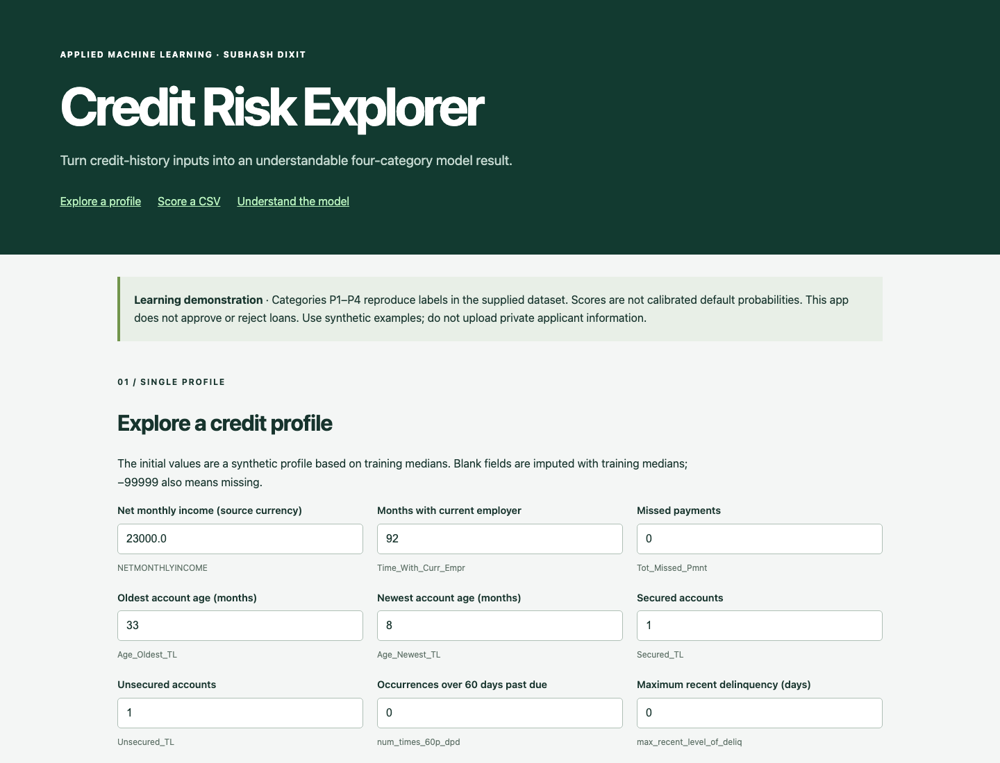
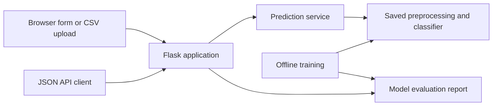
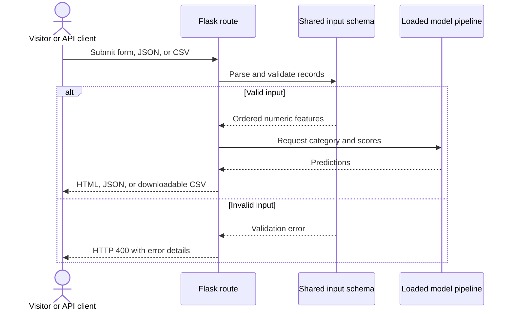
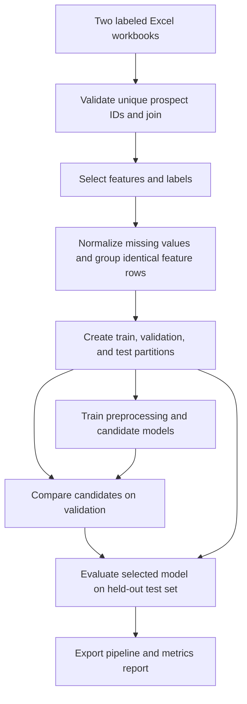
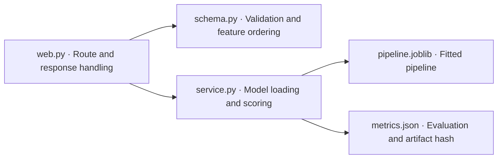
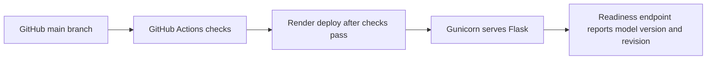

# Credit Risk Classifier

## 1. Project overview

**Credit Risk Explorer** is a web app for inspecting how a machine learning model classifies a credit profile. It uses 14 numeric inputs to predict one of four historical categories, P1 through P4. Visitors can explore a single profile, score a CSV, or inspect the model’s evaluation.

[Live demo](https://credit-risk-classifier-r0ig.onrender.com/) · [Source repository](https://github.com/subhashdixit/credit-risk-classifier) · [Model report](https://github.com/subhashdixit/credit-risk-classifier/blob/main/models/metrics.json)



## 2. Motivation and problem statement

The original case study provides credit and account history across two workbooks. A reviewer needs a reproducible way to join those records, classify a new profile consistently, and see which historical categories the model confuses. This project solves that workflow by validating the source data, fitting one shared preprocessing and classification pipeline, and serving its results through a browser form, JSON API, and CSV upload.

The model learns to reproduce the dataset’s historical `Approved_Flag` labels. The app orders them from P1 through P4, with P1 at the favorable end. The source files do not establish a default definition or prediction horizon, so the label represents a historical category.

## 3. Solution and scope

The project packages a trained classifier and its preprocessing into one saved pipeline. A browser form, JSON API, and CSV upload all call the same prediction service. Each response includes a predicted category and per-category model scores. The app also surfaces held-out performance so visitors can see which categories are harder to distinguish.

The repository includes source workbooks, reproducible training, a model report, an inference service, tests, and a deployment configuration. The public demo is intended for learning and evaluation with synthetic inputs.

## 4. Quick start and usage

1. Open the [live demo](https://credit-risk-classifier-r0ig.onrender.com/) and choose **Explore a profile**. The form starts with synthetic values based on training medians.
2. Edit a field and submit the form. Inspect the predicted category, the scores across P1–P4, and the model evidence.
3. For batch scoring, choose **Score a CSV**, download the [sample CSV](https://credit-risk-classifier-r0ig.onrender.com/sample.csv) for the required column names, then upload a synthetic file. The result downloads as a CSV.
4. For programmatic access, use the JSON endpoint described in the API table below.

## 5. High-level architecture

The same Flask application serves the web interface and the API. Training runs separately and produces the versioned model and report consumed at runtime.



## 6. End-to-end request workflow



Flask rejects request bodies larger than 1 MiB with HTTP 413. Batch requests support up to 500 records.

## 7. Data sources, inputs, and outputs

| Item | Description |
| --- | --- |
| Training source | `case_study1.xlsx` and `case_study2.xlsx`, with 51,336 rows each. The first has 26 columns and the second has 62. |
| Join key | `PROSPECTID` connects the workbooks one-to-one and is excluded from prediction. |
| Target | `Approved_Flag`, with labels P1, P2, P3, and P4. |
| Unlabeled file | `Unseen_Dataset.xlsx` contains 100 rows without target labels. Test metrics use the labeled holdout. |
| Prediction output | The selected category and per-category scores. The CSV route returns downloadable results. |

| Feature group | Model inputs |
| --- | --- |
| Income and employment | `NETMONTHLYINCOME`, `Time_With_Curr_Empr` |
| Payment history and delinquency | `Tot_Missed_Pmnt`, `num_times_60p_dpd`, `max_recent_level_of_deliq`, `num_std_12mts`, `num_sub`, `num_dbt` |
| Account mix and age | `Secured_TL`, `Unsecured_TL`, `Age_Oldest_TL`, `Age_Newest_TL` |
| Credit enquiries | `enq_L3m`, `time_since_recent_enq` |

[Source workbooks](https://github.com/subhashdixit/credit-risk-classifier/tree/main/dataset_and_materials) · [Input schema](https://github.com/subhashdixit/credit-risk-classifier/blob/main/src/credit_risk/schema.py)

## 8. Data flow and ETL pipeline



The extract step reads the workbooks. Transformation checks join cardinality, selects the 14 inputs and the target, and normalizes missing values. Grouping identical selected features before splitting keeps repeated input patterns together. The load step writes the fitted pipeline and model report to the chosen output directory. During inference, the service validates incoming rows and applies the saved transformation and classifier.

[Training implementation](https://github.com/subhashdixit/credit-risk-classifier/blob/main/scripts/train.py)

## 9. Low-level design and interfaces



`PredictionService` checks the model artifact against the SHA-256 recorded in the report and loads it during application initialization. The service reuses that pipeline across requests. The schema converts blank or null input and the source sentinel `-99999` to missing values. It rejects wholly empty profiles and checks relationships such as newest account age being less than or equal to oldest account age.

| Method | Endpoint | Contract |
| --- | --- | --- |
| GET | `/` | Renders the web interface. |
| POST | `/predict` | Scores one profile submitted through the browser form and returns HTML. |
| POST | `/api/predict` | Takes a JSON object containing a `records` array and returns JSON predictions. |
| GET | `/sample.csv` | Downloads synthetic input with the required CSV headers. |
| POST | `/predict-csv` | Takes a multipart CSV in the `file` field and returns a results CSV. |
| GET | `/api/metrics` | Returns the stored evaluation report. |
| GET | `/health/ready` | Returns readiness, model version, and deployed revision. |

## 10. Concepts and algorithms

| Concept | How and why the project uses it |
| --- | --- |
| Multiclass classification | Learns one of four historical labels from numeric features. The categories have an ordering, while the selected classifier treats them as separate classes. |
| Median imputation | Uses training medians to fill missing numeric values. The pipeline also adds missingness indicators so the model can distinguish an imputed value from a recorded value. |
| Data leakage | The split groups identical input rows and preprocessing learns from training data only. Feature availability at the original decision time still requires independent verification. |
| Majority baseline | Always predicts the dominant category and shows how much accuracy can come from class imbalance alone. |
| Logistic regression | Provides a linear multiclass benchmark. It helps test whether a more flexible model improves validation performance. |
| Random forest | Combines decision trees that can learn nonlinear relationships and interactions. The forest was selected using validation macro F1. |
| Macro F1 | Averages class-wise F1 equally, so errors on less common labels count as much as errors on the dominant label. |
| Calibration | Would test whether scores correspond to observed event frequencies. The shipped scores are uncalibrated, and the source does not define a default outcome for estimating default probabilities. |
| Permutation importance | Measures how much evaluation performance changes after shuffling a feature. It describes model reliance at the dataset level and can be affected by correlated inputs. |

## 11. Technology choices and dependencies

| Technology | Role and reason |
| --- | --- |
| Python | Shared runtime for training, evaluation, and the service. Render uses Python 3.11.11. |
| pandas 2.2.3 and openpyxl 3.1.5 | Read the Excel workbooks, join tabular records, and prepare features for the model. |
| scikit-learn 1.6.1 and joblib 1.5.3 | Fit and serialize preprocessing and classification together so inference applies the same transformations. |
| Flask 3.1.2 and Jinja2 3.1.6 | Serve the form, downloads, and JSON API from one application. |
| Gunicorn 23.0.0 | Serves the Flask application through WSGI on Render. |
| pytest, Docker, and GitHub Actions | Exercise application behavior, build the container, and validate the application through CI. |

[Runtime dependency pins](https://github.com/subhashdixit/credit-risk-classifier/blob/main/requirements.txt) · [Development dependency pins](https://github.com/subhashdixit/credit-risk-classifier/blob/main/requirements-dev.txt) · [Dependency notes](https://github.com/subhashdixit/credit-risk-classifier/blob/main/DEPENDENCIES.md)

## 12. Training, inference, and evaluation

The labeled records are split into 30,804 training, 10,266 validation, and 10,266 test rows. Training fits preprocessing and each candidate on the training partition. Validation ranks the candidates by macro F1. The selected random forest is then measured on the held-out test partition.

| Candidate | Validation accuracy | Validation macro F1 |
| --- | ---: | ---: |
| Majority-class baseline | 62.60% | 0.193 |
| Logistic regression | 67.78% | 0.635 |
| Random forest | 73.12% | 0.679 |

The selected model achieved **72.28% accuracy**, **0.667 macro F1**, and **0.736 weighted F1** on the test set. P3 is a clear weakness, with **0.361 precision** and **0.496 recall**. The model correctly classified 743 of 1,498 P3 records. It assigned 336 to P2 and 347 to P4.

The report records per-class metrics, a confusion matrix, source and model hashes, and split details. The application tests exercise inference and request handling, and the CI smoke test checks that the container starts and serves requests.

[Full metrics report](https://github.com/subhashdixit/credit-risk-classifier/blob/main/models/metrics.json) · [Confusion matrix](https://github.com/subhashdixit/credit-risk-classifier/blob/main/docs/images/confusion-matrix.png) · [Application tests](https://github.com/subhashdixit/credit-risk-classifier/blob/main/tests/test_application.py)

## 13. Limitations and data handling

- **Label provenance.** The source files leave label construction, observation dates, and a default horizon undocumented. The measured performance applies to the supplied dataset and split.
- **Generalization and fairness.** The repository reports no external validation or fairness study. Excluding demographic fields does not establish fairness because other inputs can act as proxies.
- **Score interpretation.** Treat scores as model outputs for the four historical categories. Use the demo for education with synthetic data.
- **Privacy and access.** The public app processes uploaded records in memory and does not write them to application storage. Hosting infrastructure may log request metadata. The demo has no authentication or per-user rate limiter, so use only synthetic profiles and CSVs.

## 14. Installation and local setup

Use Python 3.11 to match the deployed Python series.

```bash
git clone https://github.com/subhashdixit/credit-risk-classifier.git
cd credit-risk-classifier
python3 -m venv .venv
source .venv/bin/activate
python -m pip install --upgrade pip
python -m pip install -r requirements-dev.txt
python -m pip install --no-deps -e .
python -m pip check
python -m flask --app wsgi:app run --host 127.0.0.1 --port 8000
```

Open [the local app](http://127.0.0.1:8000/). Run the tests and optionally train a candidate into a separate directory.

```bash
python -m pytest -q
python scripts/train.py --data-dir dataset_and_materials --output-dir /tmp/credit-candidate
```

`MODEL_DIR` points the service at a directory containing compatible, trusted model artifacts. Leave it unset to use the artifacts shipped with the repository.

## 15. Repository structure

| Path | Contents |
| --- | --- |
| `src/credit_risk/` | Web routes, input schema, and prediction service. |
| `src/credit_risk/templates/`, `src/credit_risk/static/` | Browser interface and styles. |
| `dataset_and_materials/` | Input workbooks and source case-study materials. |
| `scripts/` | Training, result plotting, and smoke tests. |
| `models/` | Fitted pipeline, metrics report, and sample fixture. |
| `tests/` | Application test suite. |
| `docs/images/` | Application and model evaluation visuals. |
| `archive/` | Original project files kept for reference. |
| `wsgi.py`, `gunicorn.conf.py`, `Dockerfile`, `render.yaml` | Application entry point and deployment configuration. |
| `.github/workflows/ci.yml` | Dependency checks, linting, tests, and container smoke test. |

## 16. Deployment and operations



The public demo runs as a Render web service. The Render build installs the pinned runtime dependencies and the local package. The start command is `gunicorn --config gunicorn.conf.py wsgi:app`. The blueprint sets `/health/ready` as the health check and configures automatic deployment after checks pass.

For release verification, check readiness and its revision, then submit a synthetic profile and a sample CSV. Verify the metrics endpoint reports the intended model. If a release fails those checks, restore the last healthy revision with its matching model artifacts.

[Render configuration](https://github.com/subhashdixit/credit-risk-classifier/blob/main/render.yaml) · [CI workflow](https://github.com/subhashdixit/credit-risk-classifier/blob/main/.github/workflows/ci.yml) · [Live readiness endpoint](https://credit-risk-classifier-r0ig.onrender.com/health/ready)

## 17. License, credits, and support

Project by **Subhash Dixit**. The repository licenses its code under Apache 2.0. Check the source terms independently before redistributing the supplied case-study workbooks. Use GitHub Issues for bugs and documentation feedback. Include the deployed revision, affected endpoint, and synthetic reproduction inputs when reporting a bug.

[Code license](https://github.com/subhashdixit/credit-risk-classifier/blob/main/LICENSE) · [Case-study materials](https://github.com/subhashdixit/credit-risk-classifier/tree/main/dataset_and_materials) · [GitHub Issues](https://github.com/subhashdixit/credit-risk-classifier/issues)
